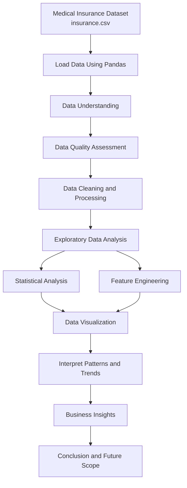

# Healthcare-Insurance-Cost-Analysis

## 1. Business Problem

Medical insurance costs vary across individuals based on demographic characteristics, lifestyle choices, and other personal factors. Understanding these variations is important for identifying factors associated with higher insurance expenses and supporting better risk assessment and cost estimation.

The objective of this project is to analyze medical insurance data, explore relationships between individual characteristics and insurance charges, and uncover meaningful patterns through exploratory data analysis and visualization.

## 2. Project Overview

The Medical Insurance EDA Project focuses on performing Exploratory Data Analysis (EDA) on a medical insurance dataset using Python. The analysis examines demographic and lifestyle-related variables to understand their association with medical insurance charges.

Python libraries such as Pandas, NumPy, Matplotlib, and Seaborn are used to inspect the dataset, perform statistical analysis, explore relationships between variables, and visualize important trends.

## 3. Project Objectives

- Understand the structure, size, and characteristics of the medical insurance dataset.
- Identify missing values, duplicate records, and potential data quality issues.
- Analyze the distribution of medical insurance charges and other numerical variables.
- Explore relationships between age, BMI, smoking status, number of children, region, and insurance charges.
- Use data visualization to identify patterns, trends, and potential outliers.
- Extract meaningful insights to understand factors associated with variations in medical insurance costs.
- Develop a foundation for further statistical analysis and potential predictive modeling.

## 4. Project Workflow

1. **Data Collection:** Load the medical insurance dataset from a CSV file.
2. **Data Understanding:** Examine dataset dimensions, column names, data types, and statistical summaries.
3. **Data Cleaning and Processing:** Check for missing values, duplicate records, inconsistent data types, and potential data quality issues.
4. **Exploratory Data Analysis:** Analyze individual variables and investigate relationships between features.
5. **Data Visualization:** Create charts and plots to identify distributions, trends, and patterns.
6. **Feature Engineering and Extraction:** Create useful categories or derived features where appropriate.
7. **Business Insights:** Interpret the analysis and identify factors associated with insurance charges.
8. **Conclusion:** Summarize the findings and outline potential opportunities for further analysis.

### Workflow Diagram

## 5. Data Cleaning and Processing

Data cleaning and processing help ensure that the dataset is suitable for meaningful analysis.

- **Dataset Inspection:** Examine the number of rows and columns, feature names, and data types.
- **Missing Value Analysis:** Check for null or missing values and determine whether treatment is required.
- **Duplicate Detection:** Identify duplicate records and assess whether they need to be removed.
- **Data Type Validation:** Verify that numerical and categorical variables have appropriate data types.
- **Statistical Summary:** Use descriptive statistics to understand the distribution and range of numerical variables.
- **Outlier Analysis:** Examine variables such as age, BMI, and insurance charges for unusually high or low values.
- **Categorical Data Analysis:** Inspect categories such as sex, smoking status, and region for consistency.

Any cleaning, removal, or transformation should be performed only when required by the actual dataset and analysis.

## 6. Feature Engineering and Extraction

Feature engineering involves creating or transforming variables to make the data easier to analyze and reveal useful patterns.

Potential approaches for this project include:

- **Age Grouping:** Group individuals into age ranges to compare insurance charges across different age groups.
- **BMI Categorization:** Categorize Body Mass Index (BMI) values into meaningful groups to explore their relationship with insurance costs.
- **Smoking Status Analysis:** Compare insurance charges between smokers and non-smokers.
- **Family Size Analysis:** Use the number of children to investigate differences in insurance charges.
- **Regional Analysis:** Compare insurance charges across geographical regions.
- **Feature Relationship Analysis:** Examine combinations of variables, such as age and smoking status or BMI and smoking status, to understand their relationship with insurance charges.

These approaches can support detailed comparisons and improve the interpretability of the exploratory analysis.

*Note: The feature engineering steps above should be described as completed work only if they are implemented in the notebook.*

## 7. Business Insights

The exploratory data analysis helps investigate patterns and relationships between demographic characteristics, lifestyle factors, and medical insurance charges.

- **Age and Insurance Charges:** Analyze how insurance costs vary across different age groups and identify potential trends between age and medical expenses.
- **BMI and Insurance Charges:** Examine the relationship between BMI and insurance charges to understand whether higher BMI values are associated with higher costs.
- **Smoking Status:** Compare insurance charges between smokers and non-smokers to evaluate the association between smoking habits and insurance expenses.
- **Family Size:** Investigate whether the number of children is associated with variations in medical insurance charges.
- **Regional Differences:** Compare insurance charges across geographical regions to identify potential regional variations.
- **Combined Factors:** Explore how factors such as age, BMI, and smoking status jointly relate to medical insurance charges.

These insights can help identify variables that may be important for understanding differences in insurance expenses and support further data-driven investigation.

## 8. Project Outcomes

- Performed exploratory data analysis on medical insurance data using Python.
- Examined numerical and categorical variables using statistical summaries and visualization techniques.
- Assessed data quality through checks for missing values, duplicate records, data types, and potential outliers.
- Explored relationships between demographic characteristics, lifestyle factors, and insurance charges.
- Identified analytical approaches for comparing insurance expenses across different customer segments.
- Established a foundation for further statistical analysis and potential medical insurance cost prediction.

## 9. Tools and Technologies

| Tool / Technology | Purpose |
|---|---|
| Python | Data analysis and processing |
| Pandas | Data manipulation and analysis |
| NumPy | Numerical operations |
| Matplotlib | Data visualization |
| Seaborn | Statistical visualization |
| Jupyter Notebook | Interactive analysis and documentation |

## 10. Conclusion

This project demonstrates how Exploratory Data Analysis can be used to understand medical insurance data, investigate factors associated with insurance charges, and uncover patterns through statistical summaries and visualizations.

By examining demographic and lifestyle-related variables, the analysis provides a foundation for understanding variations in medical insurance expenses. The project can be extended through additional feature engineering, statistical hypothesis testing, and machine learning techniques to explore insurance cost prediction.

## 11. Future Scope

- Perform statistical hypothesis testing to evaluate relationships between variables.
- Develop machine learning models to predict medical insurance charges.
- Evaluate model performance using appropriate regression metrics.
- Build an interactive dashboard to present insurance cost patterns and insights.
- Explore additional features or datasets to improve analysis and generalizability.
